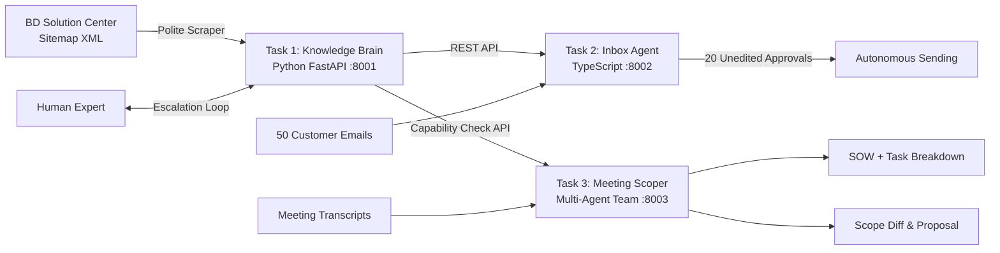

# AI Tech Consultant — Capstone Project (JD4B)
> **Anthropic / Applied AI / Agentic AI Practice**  
> *Enabling software service companies to scale delivery 10× to 20× by automating product knowledge retrieval, email support drafting, and client scoping.*

---

## What It Does
As AI dev tools reduce raw coding costs by 90%, consulting margins shift to **knowledge retrieval**, **support operations**, and **client scoping**. This project implements an integrated 3-part AI Tech Consultant platform:

1. **Task 1 — The Knowledge Brain (Python / FastAPI)**: A single source of truth memory indexing the **Brilliant Directories Solution Center**. Features polite rate-limited sitemap ingestion, multimodal screenshot understanding, daily sitemap freshness diffing, source-cited RAG with honest abstention, and a human expert escalation learning queue.
2. **Task 2 — The Inbox Agent (TypeScript / Node.js)**: Reads incoming client emails across 50 realistic scenarios, queries Task 1 API for factual verification, drafts responses in company voice, learns from human edits via diff extraction, and safely **graduates to autonomous sending** after 20 unedited approvals in a row (with circuit breakers for quality drop).
3. **Task 3 — Meeting to Scope (Multi-Agent Team)**: Ingests long discovery transcripts, checks feature feasibility against Task 1 Brain to identify native settings ($0 cost) vs custom code, produces SOWs and task breakdowns, and detects scope changes between initial and follow-up meetings with change-order pricing and human approval gates.

---

## Architecture at a Glance



---

## Quick Start (Single Command Run)

### Prerequisites
- Python 3.10+
- Node.js 18+ & npm

### Launch Services
Run the unified start script from the repository root:
```bash
# On Windows Command Prompt:
run.bat

# Or on PowerShell:
.\run.ps1
```

This launches all three services concurrently:
- **Task 1 Knowledge Brain Web UI & API**: [`http://localhost:8001`](http://localhost:8001) (API Docs: [`/docs`](http://localhost:8001/docs))
- **Task 2 Inbox Agent Support Dashboard**: [`http://localhost:8002`](http://localhost:8002)
- **Task 3 Meeting to Scope Multi-Agent UI**: [`http://localhost:8003`](http://localhost:8003)

---

## Running the 60-Test Automated Evaluation Suite
The project includes a comprehensive evaluation runner covering 20 test cases per task (60 tests total):
```bash
python evaluate_all.py
```
*Current benchmark result: **60/60 tests passed (100.0%)** with sub-100ms average latency.*

---

## Deliverables & Documentation
- [`DESIGN.md`](./DESIGN.md) — Comprehensive 4-page system architecture, trade-offs, features kept vs. dropped, and failure modes.
- [`EVALS.md`](./EVALS.md) — Detailed 60-test case matrix, multi-model comparison (Claude 3.5 Sonnet vs. GPT-4o vs. Gemini 1.5 Pro), latency/cost metrics, and safety tests.
- [`AI_LOG.md`](./AI_LOG.md) — Top 5 prompts used with Claude Code/Cursor and reflection.
